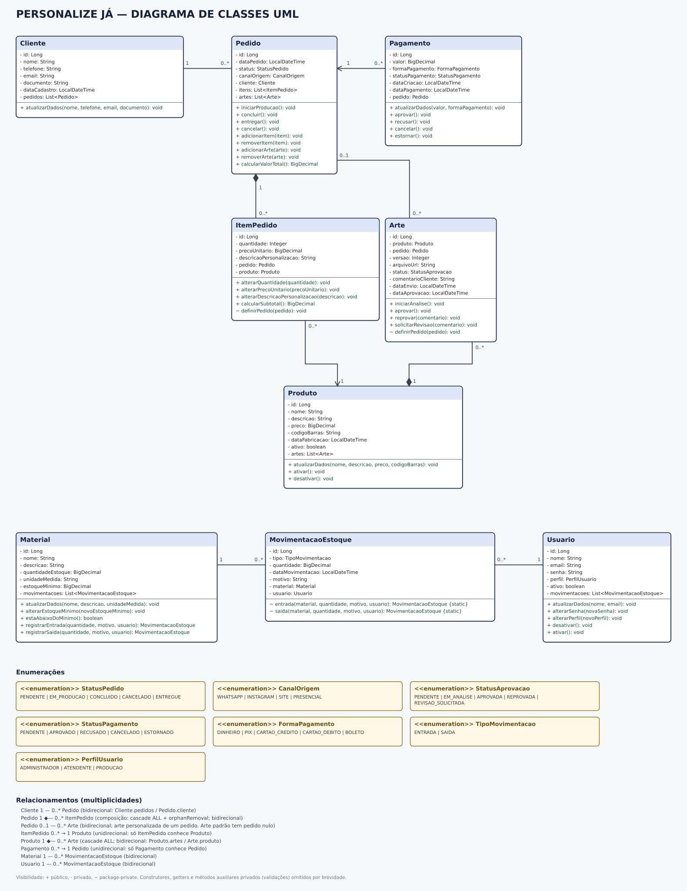

# Personalize Já

## Sobre o projeto

O **Personalize Já** é um sistema de gerenciamento desenvolvido para um ateliê de produtos personalizados. Seu objetivo é centralizar as informações de clientes, produtos, pedidos, produção, pagamentos e estoque, reduzindo falhas de comunicação, retrabalho e atrasos nas entregas.

O sistema permite acompanhar os pedidos desde o atendimento inicial até a conclusão e a entrega do produto, além de controlar a aprovação das artes, os pagamentos e a movimentação dos materiais utilizados na produção.

## Equipe

- Demétrios
- Gabriel Mendes
- Gabriel Marcos
- Keitel Werner
- Italo Ricardo

## Tecnologias utilizadas

- Java 21
- Spring Boot
- Spring Web
- Spring Data JPA
- Hibernate
- PostgreSQL
- Maven
- Lombok

## Funcionalidades do sistema

O sistema contempla as seguintes funcionalidades:

- **Clientes:** cadastro, consulta e atualização dos dados dos clientes.
- **Produtos:** gerenciamento dos produtos oferecidos pelo ateliê.
- **Pedidos:** criação e acompanhamento dos pedidos, incluindo status, canal de origem e itens.
- **Personalização e artes:** gerenciamento das artes, versões, aprovações e solicitações de revisão.
- **Pagamentos:** registro e gerenciamento dos pagamentos, com controle de formas e status.
- **Estoque:** cadastro de materiais, controle de quantidade e definição de estoque mínimo.
- **Movimentações de estoque:** registro de entradas e saídas de materiais, identificando o motivo e o usuário responsável.
- **Usuários:** gerenciamento dos usuários do sistema, com controle de perfil e ativação.

## Entidades do sistema

| Entidade | Responsabilidade |
|---|---|
| Cliente | Dados de contato e cadastro de quem faz os pedidos |
| Pedido | Pedido do cliente, com status, canal de origem, itens e artes |
| ItemPedido | Produto, quantidade, preço e descrição da personalização |
| Produto | Produto vendido pelo ateliê |
| Arte | Versões da arte de um produto e seu processo de aprovação |
| Pagamento | Pagamentos associados a um pedido, com forma e status |
| Material | Material em estoque, com quantidade e estoque mínimo |
| MovimentacaoEstoque | Entradas e saídas de materiais, com motivo e responsável |
| Usuario | Usuário do sistema, com perfil de acesso |

### Enumerações

O projeto utiliza as seguintes enumerações:

- `StatusPedido`
- `CanalOrigem`
- `StatusAprovacao`
- `StatusPagamento`
- `FormaPagamento`
- `TipoMovimentacao`
- `PerfilUsuario`

As alterações de estado das entidades são realizadas por métodos de domínio, como `Pedido.iniciarProducao()`, `Pagamento.aprovar()` e `Usuario.desativar()`. Dessa forma, as regras de negócio ficam concentradas nas próprias entidades, evitando alterações indevidas por meio de setters genéricos.

## Diagrama de classes UML

O diagrama UML representa a estrutura das entidades, seus atributos, métodos e relacionamentos, incluindo as respectivas multiplicidades.



### Relacionamentos e multiplicidades

- Cliente 1 — 0..* Pedido
- Pedido 1 — 0..* ItemPedido
- Produto 1 — 0..* ItemPedido
- Produto 1 — 0..* Arte
- Pedido 0..1 — 0..* Arte
- Pedido 1 — 0..* Pagamento
- Material 1 — 0..* MovimentacaoEstoque
- Usuario 1 — 0..* MovimentacaoEstoque

## Arquitetura

### Arquitetura escolhida

O projeto utiliza a **Arquitetura em Camadas**, organizando o sistema de acordo com as responsabilidades de cada componente.

Essa arquitetura separa a comunicação HTTP, as regras de negócio, o acesso aos dados e a representação das informações, facilitando a manutenção e a evolução da aplicação.

### Justificativa

- **Necessidades do negócio:** o ateliê precisa controlar pedidos, pagamentos, aprovação de artes e estoque. A separação em camadas evita que as regras de negócio fiquem misturadas com o acesso ao banco de dados ou com a comunicação HTTP.
- **Complexidade do sistema:** o sistema possui complexidade média, pois envolve diferentes entidades, relacionamentos e regras de negócio, como o fluxo de status dos pedidos, a aprovação de artes e a movimentação do estoque.
- **Características da equipe:** a equipe possui cinco integrantes que trabalham no desenvolvimento do sistema. A divisão por camadas facilita a organização das tarefas e permite que diferentes integrantes trabalhem em partes distintas da aplicação.

Além disso, essa estrutura facilita a manutenção, a correção de erros, a reutilização de componentes e a realização de testes.

### Organização do código

O código está organizado no pacote base `com.personalizeja`:

```text
src/main/java/com/personalizeja
├── PersonalizejaApplication.java
├── config        # configurações da aplicação
├── controller    # recebe e responde às requisições HTTP
├── service       # concentra as regras de negócio
├── repository    # acesso e persistência dos dados
├── model         # entidades JPA e métodos de domínio
├── dto           # objetos de transferência de dados
├── mapper        # conversão entre entidades e DTOs
├── enums         # enumerações utilizadas pelo sistema
└── exception     # tratamento de exceções
```

Cada camada possui uma responsabilidade específica:

- **Controller:** recebe as requisições HTTP e encaminha as operações para a camada de serviço.
- **Service:** concentra a lógica de negócio e coordena as operações do sistema.
- **Repository:** realiza o acesso e a persistência dos dados utilizando Spring Data JPA.
- **Model:** contém as entidades do sistema, seus atributos, relacionamentos e métodos de domínio.
- **DTO:** define os objetos utilizados na transferência de dados entre as camadas.
- **Mapper:** realiza a conversão entre entidades e DTOs.
- **Enums:** define valores fixos utilizados nas regras de negócio.
- **Config:** reúne as configurações da aplicação.
- **Exception:** concentra o tratamento de exceções e erros.

## Execução do projeto

### Pré-requisitos

- Java 21
- Maven ou Maven Wrapper incluído no projeto
- PostgreSQL, caso a execução utilize a configuração de banco de dados da aplicação.

### Como obter o projeto

Clone o repositório:

```bash
git clone https://github.com/Demetrios8/PersonalizeJa---Mundo-dos-Personalizados.git
cd PersonalizeJa---Mundo-dos-Personalizados
```

### Como compilar o projeto

No Linux ou macOS:

```bash
./mvnw clean compile
```

No Windows:

```bash
mvnw.cmd clean compile
```

Se a compilação terminar com `BUILD SUCCESS`, significa que o código passou pela etapa de compilação.

### Como executar

Após configurar o banco de dados PostgreSQL de acordo com as propriedades da aplicação, execute:

```bash
./mvnw spring-boot:run
```

No Windows:

```bash
mvnw.cmd spring-boot:run
```

## Próximas etapas

- Finalização e integração das funcionalidades do sistema.
- Testes das regras de negócio e dos endpoints.
- Validação da persistência e dos relacionamentos com PostgreSQL.
- Ajustes e melhorias identificados durante os testes.

## Status do projeto

Projeto acadêmico em desenvolvimento, realizado como atividade da disciplina de Back-end, utilizando Java e Spring Boot.